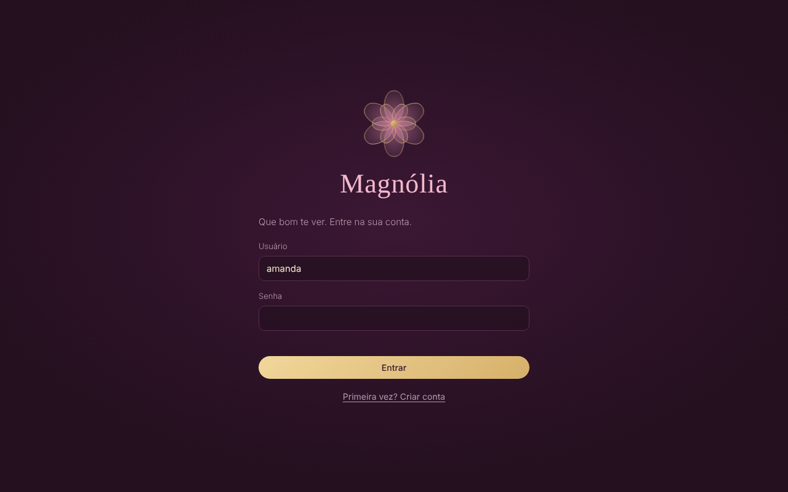

# ✿ Magnólia: assistente pessoal com Gemini

Uma assistente pessoal inspirada no J.A.R.V.I.S. do Homem de Ferro, feita em Python com a API do Google Gemini.
Você diz **"Ei, Magnólia"** e conversa com ela em voz alta, em tempo real. Ela pesquisa na internet, cuida
da sua **Google Agenda, Planilhas, Docs, Drive e Gmail**, cria lembretes e **lembra de você** de uma conversa para outra.


> Projeto de portfólio de **Amanda Maciel Pasqualotto**, estudante de Direito e de Tecnologia da Informação (UFMS).

---

## ✨ O que ela faz

| Habilidade | Exemplos do que dizer |
|---|---|
| 🎙️ Voz em tempo real + "Ei, Magnólia" | "Ei, Magnólia... que horas são?" |
| 📅 Google Agenda | "O que eu tenho amanhã?", "Marca dentista sexta às 15h" |
| 📊 Google Planilhas | "Adiciona na planilha Gastos: hoje, mercado, 85 reais" |
| 📄 Google Docs e Drive | "Cria um documento com as ideias que te falei", "Acha o arquivo do TCC" |
| ✉️ Gmail | "Tenho e-mail não lido?", "Escreve um rascunho para o professor" |
| 📚 Biblioteca: arquivos, páginas e sites de notícias, organizados em coleções | "O que tem no meu cronograma essa semana?", "Busca 'prescrição' na coleção direito" |
| ⚡ Comandos personalizados criados no chat | "Cria um comando 'resumo jurídico' que resume as novidades da coleção direito" |
| ⭐ Favoritos do navegador | "Abre o AVA da faculdade", "Quais sites de vagas eu salvei?" |
| 📰 Notícias dos seus sites favoritos (RSS) | "Quais as notícias em alta hoje?", "Adiciona o g1 na coleção notícias" |
| 🔎 Pesquisa na web e notícias | "Quais as notícias de tecnologia hoje?" |
| 🌦️ Previsão do tempo | "Vai chover amanhã em São Paulo?" |
| ⏰ Lembretes e notificações | "Me lembra de beber água em 30 minutos" |
| 🧠 Memória de longo prazo | "Lembra que eu prefiro respostas curtas" |
| 💻 Computador | "Como está a bateria?", "Abre o VS Code", "Toca Back in Black no YouTube" |

São **45 ferramentas** no total.

## 🔐 Contas e segurança

Cada pessoa que usa a Magnólia no mesmo computador tem **login e senha** e uma pasta própria, com
memória, chave da API e acesso ao Google separados.

- A senha **nunca é guardada**: fica só um hash PBKDF2-SHA256 com 600 mil iterações e sal aleatório.
- A chave do Gemini, o token do Google e os textos da biblioteca ficam **criptografados** (Fernet/AES) com uma chave derivada da senha.
- O Gmail é **somente leitura + rascunhos**: a Magnólia nunca envia e-mail sozinha.
- Os favoritos do navegador são **apenas lidos** do arquivo local do Chrome/Edge/Brave; nada é alterado.
- O "Ei, Magnólia" roda **offline** (Vosk): nenhum áudio sai do computador antes de você chamá-la.
- Dados pessoais (`data/`) e o `.env` estão no `.gitignore` e nunca vão para o GitHub.



## 🧩 Arquitetura

```
main.py                    ← abre a janela (ou o modo terminal)
magnolia/
├── gui/                   ← interface: HTML/CSS/JS numa janela do Edge ou Chrome
│   ├── app.py             ← o que a tela pode pedir ao Python
│   ├── server.py          ← servidor local (só 127.0.0.1, com código secreto)
│   └── web/               ← index.html, style.css, app.js
├── assistant.py           ← "maestro": junta texto, voz e palavra de ativação
├── brain.py               ← modo texto: Gemini + chamada automática de funções
├── voice.py               ← modo voz: Gemini Live API (áudio bidirecional)
├── wakeword.py            ← "Ei, Magnólia" com Vosk (offline)
├── accounts.py            ← contas locais, hash de senha, criptografia
├── google_auth.py         ← login OAuth com o Google
├── library.py             ← biblioteca: arquivos, páginas, sites, coleções e comandos
├── feeds.py               ← leitura de feeds RSS/Atom e do texto de páginas
├── memory.py · prompt.py · config.py
└── tools/                 ← habilidades (cada arquivo é descoberto sozinho)
```

**Como as ferramentas funcionam:** toda função marcada com `@tool` dentro de `magnolia/tools/` vira uma
habilidade. O Gemini lê o nome, os parâmetros e a docstring e decide sozinho quando chamá-la. Para ensinar
algo novo à Magnólia, basta criar um arquivo:

```python
from magnolia.tools import tool

@tool
def jogar_dado(lados: int = 6) -> str:
    """Joga um dado e devolve o resultado."""
    import random
    return str(random.randint(1, lados))
```

Outras decisões de projeto:
- **Fallback de modelos:** se um modelo estoura a cota ou sai do ar, ela troca para o próximo sem perder a conversa.
- **Erros não derrubam a assistente:** uma ferramenta que falha devolve o erro ao modelo, que explica o que houve.
- **Antieco:** sem fone, o microfone fica mudo enquanto ela fala, para não responder a si mesma.
- **Economia de cota:** depois de 40 s de silêncio ela "volta a dormir" e desconecta do Gemini.
- **Janela sem dependências frágeis:** a interface abre no Edge ou no Chrome em modo aplicativo, servida por um servidor local que só aceita o próprio computador e exige um código secreto por execução.
- **Testes sem internet:** APIs externas são substituídas por mocks; os testes não gastam cota.

## 🚀 Como instalar

Pré-requisito: **Python 3.11 ou mais novo**.

```bash
git clone https://github.com/SEU-USUARIO/magnolia.git
cd magnolia
python -m venv .venv
# Windows: .venv\Scripts\activate    |    Mac/Linux: source .venv/bin/activate
pip install -r requirements.txt
python main.py
```

Na primeira vez, crie sua conta na tela e cole sua chave gratuita do
[Google AI Studio](https://aistudio.google.com/apikey). Na primeira vez que você ligar a voz com
"Ei, Magnólia", ela baixa sozinha o reconhecedor offline (~31 MB).

**Atalho (Windows):** rode uma vez `python main.py --atalho` e a Magnólia ganha um ícone na Área de
Trabalho e no Menu Iniciar. Ela abre com dois cliques, sem terminal; as mensagens de diagnóstico vão para
`data/magnolia.log`.

Outros modos:

```bash
python main.py --texto --usuario amanda      # conversa por texto no terminal
python main.py --voz --ei --usuario amanda   # voz no terminal, com "Ei, Magnólia"
python -m pytest                             # roda os testes
```

## 🔗 Conectar o Google (uma vez só)

1. Entre no [Google Cloud Console](https://console.cloud.google.com/) e crie um projeto.
2. Em **APIs e serviços → Biblioteca**, ative: Google Calendar API, Google Sheets API, Google Docs API,
   Google Drive API e Gmail API.
3. Em **Tela de permissão OAuth**, escolha "Externo", preencha o nome do app e adicione seu e-mail
   (e o de quem mais for usar) em **Usuários de teste**.
4. Em **Credenciais → Criar credenciais → ID do cliente OAuth**, escolha **App para computador**.
5. Baixe o JSON, renomeie para `google_credentials.json` e coloque na pasta `data/`.
6. Na Magnólia, abra ⚙ **Configurações → Conectar Google** e autorize no navegador.

> **Dica:** enquanto o app está "Em teste", o Google faz a conexão vencer a cada 7 dias. Para uso pessoal,
> vá em **Público-alvo → Publicar app** e conecte de novo: a conexão para de vencer. O Google continua
> mostrando o aviso de "app não verificado" (é o seu próprio app) e limita o uso a 100 contas.

## 🗺️ Próximos passos

- [ ] Instalador (.exe) para quem não programa
- [ ] Lembretes que sobrevivem ao reiniciar
- [ ] Visão: a Magnólia enxerga a tela e a webcam
- [ ] Monitorar atividade física

## 🙏 Créditos

A organização das habilidades foi inspirada no projeto
[MARK LVII de FatihMakes](https://www.youtube.com/@FatihMakes) (CC BY-NC 4.0).
Todo o código deste repositório foi escrito do zero.

## 📄 Licença

MIT
