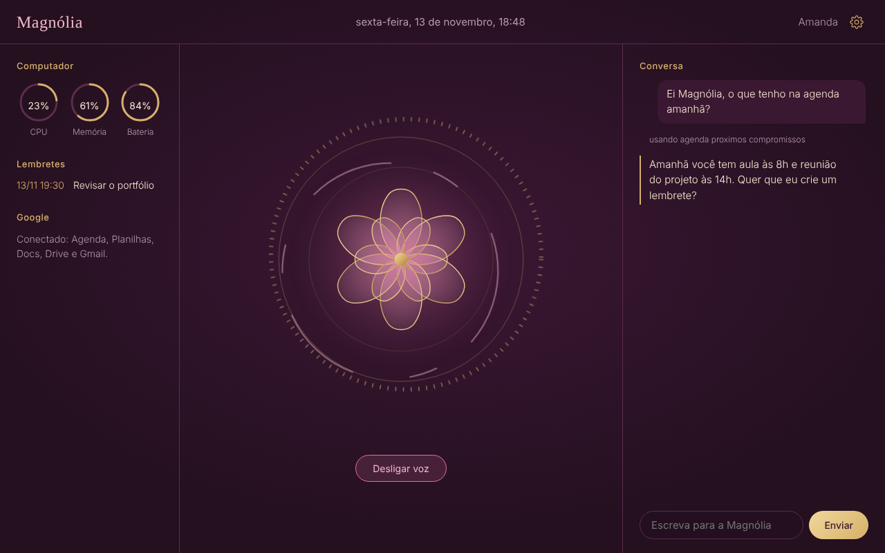

<div align="center">


<a href="https://git.io/typing-svg">
  
</a>

<br/><br/>

### <a href="#english">🇺🇸 English</a> &nbsp;|&nbsp; <a href="#portugues">🇧🇷 Português</a>

<br/>


<br/>



</div>

<br/>

<!-- ======================================================== -->
<!-- ======================= ENGLISH ======================== -->
<!-- ======================================================== -->

<a id="english"></a>

# 🇺🇸 English

## 🌸 About the project

> *"What if I had my own J.A.R.V.I.S.? Not a copy of someone else's, but one I understand line by line."*

**Magnólia** is a personal voice assistant inspired by J.A.R.V.I.S. from *Iron Man*, built in Python with the
**Google Gemini API**. You say **"Ei, Magnólia"** and talk to her out loud, in real time. She checks your
**Google Calendar, Gmail, Sheets, Docs and Drive**, reads the news from your favorite sites, consults your own
documents, sets reminders and **remembers you** from one conversation to the next.

- 🎙️ **Real-time voice** with the Gemini Live API, plus a local wake word that works **offline**
- 📅 **Google Workspace** integration via OAuth: Calendar, Gmail, Sheets, Docs and Drive
- 📚 **Personal library**: PDFs, Word files, saved web pages and news sites, organized in collections
- ⚡ **Custom commands** created by chatting: *"create a command 'legal summary' that..."*
- 🔐 **Privacy by design**: local accounts, hashed passwords and encrypted data
- 🌷 A pink-and-gold **HUD interface** with a magnolia flower that blooms with her voice

<br/>

## 🧭 How it was built

<div align="center">

<table>
<tr>
<td align="center" width="20%">🔍<br/><b>Research</b><br/><sub>Studied MARK LVII</sub></td>
<td align="center">➜</td>
<td align="center" width="20%">🤖<br/><b>v0.1 JARVIS</b><br/><sub>Text + voice core</sub></td>
<td align="center">➜</td>
<td align="center" width="20%">🌸<br/><b>v0.2 Magnólia</b><br/><sub>HUD · accounts · Google</sub></td>
<td align="center">➜</td>
<td align="center" width="20%">📚<br/><b>v0.3 Library</b><br/><sub>Collections · commands</sub></td>
<td align="center">➜</td>
<td align="center" width="20%">🖥️<br/><b>Desktop</b><br/><sub>Shortcut · icon</sub></td>
</tr>
</table>

</div>

I started from an open-source assistant (MARK LVII, ~30,000 lines) to study how a voice assistant works, and
decided to **write my own from scratch**, small enough to understand every part (~3,100 lines of Python).
I built it in **pair programming with Claude (Anthropic)**: I defined the product (name, voice, colors,
features, privacy rules), tested every version on my own computer and brought back the errors; Claude
proposed the architecture and wrote the code with me. The whole evolution is in the commit history.

**Real problems we solved along the way:**

| Problem | Solution |
|---|---|
| The native window crashed on Windows (`pythonnet`/.NET) | The UI became a local server opened in Edge/Chrome **app mode**, protected by a per-run secret token |
| Hard-coded Gemini model names returned *404* for my API key | Magnólia **asks Google which models the key can use** and picks the best one, with automatic fallback |
| Voice failed with *HTTP 404* on the WebSocket | The SDK started defaulting to API `v1`; the Live API only exists in **`v1beta`** |
| The assistant answering its own voice | **Anti-echo**: the mic is muted while she speaks (unless you use headphones) |
| Google tokens expiring every 7 days | Documented the OAuth publishing flow and wrote a **privacy policy** for the app |

<br/>

## 🛠️ Tech Stack

<table>
<tr>
<td width="50%" valign="top">

### 🤖 AI & Voice


</td>
<td width="50%" valign="top">

### 💻 Languages & Core


</td>
</tr>
<tr>
<td width="50%" valign="top">

### 🔗 Google Workspace (OAuth 2.0)


</td>
<td width="50%" valign="top">

### 🔐 Security & Privacy


</td>
</tr>
<tr>
<td width="50%" valign="top">

### 🌐 Web & Data


</td>
<td width="50%" valign="top">

### 🧰 Tools & Quality


</td>
</tr>
</table>

<br/>

## ✨ What she does

| Skill | Try saying |
|---|---|
| 🎙️ Voice + wake word | *"Ei, Magnólia... what time is it?"* |
| 📅 Google Calendar | *"What do I have tomorrow?"*, *"Book dentist on Friday at 3pm"* |
| ✉️ Gmail (read + drafts only) | *"Any unread emails?"*, *"Draft an email to my professor"* |
| 📊 Sheets · 📄 Docs · 🗂️ Drive | *"Add to my Expenses sheet: today, groceries, 85"* |
| 📚 Library with collections | *"What's on my schedule this week?"*, *"Search 'prescription' in the law collection"* |
| 📰 News from your favorite sites | *"What's trending today?"* |
| ⚡ Custom commands | *"Create a command 'good morning' with the weather, my day and 3 headlines"* |
| ⏰ Reminders · 🧠 Memory | *"Remind me to drink water in 30 minutes"*, *"Remember I prefer short answers"* |
| 💻 Computer · 🌦️ Weather · ⭐ Bookmarks | *"How's the battery?"*, *"Open my university portal"* |

**45 tools** in total, each one a plain Python function the model can call.

<br/>

## 🧩 Architecture

| Layer | Files | What it does |
|---|---|---|
| 🖥️ Interface | `gui/web/` · `gui/server.py` | HTML/CSS/JS HUD served locally (127.0.0.1 + secret token), live events via SSE |
| 🎼 Orchestrator | `assistant.py` | Joins text, voice and wake word |
| 🧠 Brain | `brain.py` · `models.py` | Gemini chat with automatic function calling and model fallback |
| 🎙️ Voice | `voice.py` · `wakeword.py` | Live API audio streaming (5 asyncio tasks) + offline Vosk wake word |
| 🧰 Tools | `tools/*.py` | Every function marked `@tool` is auto-discovered |
| 🔐 Accounts | `accounts.py` · `google_auth.py` | Local login, encryption, Google OAuth |
| 📚 Library | `library.py` · `feeds.py` | Files, pages, feeds, collections and commands |

Teaching Magnólia something new takes one file:

```python
from magnolia.tools import tool

@tool
def roll_dice(sides: int = 6) -> str:
    """Rolls a die and returns the result."""
    import random
    return str(random.randint(1, sides))
```

<br/>

## 🔐 Privacy & Security

| | |
|---|---|
| 🔑 **Passwords** | Never stored: only a PBKDF2-SHA256 hash (600k iterations, random salt) |
| 🗝️ **Secrets** | Gemini key, Google token and library texts are **encrypted** with a key derived from the password |
| ✉️ **Gmail** | Read-only + drafts: Magnólia **never sends** emails on her own |
| 🎧 **Microphone** | The wake word runs **offline**; no audio leaves the computer before you call her |
| 🧱 **Local server** | Accepts only `127.0.0.1` and requires a secret token per run |
| 📄 **Policy** | [Privacy Policy](PRIVACIDADE.md) (in Portuguese) |

<br/>

## 🚀 Getting started

Requires **Python 3.11+** and a free key from [Google AI Studio](https://aistudio.google.com/apikey).

```bash
git clone https://github.com/amandapasqualotto/MagnoliaAI.git
cd MagnoliaAI
python -m venv .venv
.venv\Scripts\activate          # Mac/Linux: source .venv/bin/activate
pip install -r requirements.txt
python main.py                  # opens the app: create your account and paste your key
python main.py --atalho         # (Windows) desktop shortcut, opens with a double click
python -m pytest                # runs the 33 tests (no internet, no API quota)
```

To connect Google, follow the step-by-step guide in the Portuguese section ([Conectar o Google](#conectar-google)).

<br/>

<div align="center">

<a href="#portugues">🇧🇷 Ler em Português</a> &nbsp;|&nbsp; <a href="#english">⬆️ Back to top</a>

</div>

<br/>

---

<br/>

<!-- ======================================================== -->
<!-- ====================== PORTUGUÊS ======================= -->
<!-- ======================================================== -->

<a id="portugues"></a>

# 🇧🇷 Português

## 🌸 Sobre o projeto

> *"E se eu tivesse o meu próprio J.A.R.V.I.S.? Não uma cópia do de outra pessoa, mas um que eu entendesse linha por linha."*

A **Magnólia** é uma assistente pessoal por voz inspirada no J.A.R.V.I.S. do *Homem de Ferro*, feita em Python
com a **API do Google Gemini**. Você diz **"Ei, Magnólia"** e conversa com ela em voz alta, em tempo real.
Ela consulta sua **Google Agenda, Gmail, Planilhas, Docs e Drive**, lê as notícias dos seus sites favoritos,
consulta seus próprios documentos, cria lembretes e **lembra de você** de uma conversa para outra.

- 🎙️ **Voz em tempo real** com a Gemini Live API, e palavra de ativação que funciona **offline**
- 📅 Integração com o **Google Workspace** via OAuth: Agenda, Gmail, Planilhas, Docs e Drive
- 📚 **Biblioteca pessoal**: PDFs, Word, páginas salvas e sites de notícias, organizados em coleções
- ⚡ **Comandos personalizados** criados conversando: *"cria um comando 'resumo jurídico' que..."*
- 🔐 **Privacidade desde a concepção**: contas locais, senhas com hash e dados criptografados
- 🌷 **Interface HUD** rosa e dourada, com uma flor de magnólia que abre as pétalas no ritmo da voz

<br/>

## 🧭 Como foi construída

<div align="center">

<table>
<tr>
<td align="center" width="20%">🔍<br/><b>Pesquisa</b><br/><sub>Estudo do MARK LVII</sub></td>
<td align="center">➜</td>
<td align="center" width="20%">🤖<br/><b>v0.1 JARVIS</b><br/><sub>Núcleo texto + voz</sub></td>
<td align="center">➜</td>
<td align="center" width="20%">🌸<br/><b>v0.2 Magnólia</b><br/><sub>HUD · contas · Google</sub></td>
<td align="center">➜</td>
<td align="center" width="20%">📚<br/><b>v0.3 Biblioteca</b><br/><sub>Coleções · comandos</sub></td>
<td align="center">➜</td>
<td align="center" width="20%">🖥️<br/><b>Desktop</b><br/><sub>Atalho · ícone</sub></td>
</tr>
</table>

</div>

Comecei estudando um assistente de código aberto (o MARK LVII, com cerca de 30 mil linhas) para entender
como um assistente de voz funciona, e decidi **escrever o meu do zero**, pequeno o bastante para eu entender
cada parte (cerca de 3.100 linhas de Python). Construí em **programação em par com o Claude (Anthropic)**: eu
defini o produto (nome, voz, cores, funcionalidades, regras de privacidade), testei cada versão no meu
computador e trouxe os erros de volta; o Claude propôs a arquitetura e escreveu o código comigo. Toda a
evolução está no histórico de commits.

**Problemas reais que resolvemos no caminho:**

| Problema | Solução |
|---|---|
| A janela nativa travava no Windows (`pythonnet`/.NET) | A interface virou um servidor local aberto no Edge/Chrome em **modo aplicativo**, protegido por um código secreto a cada execução |
| Nomes fixos de modelo do Gemini davam *404* para a minha chave | A Magnólia **pergunta ao Google quais modelos a chave pode usar** e escolhe o melhor, com troca automática |
| A voz falhava com *HTTP 404* no WebSocket | A biblioteca passou a usar a API `v1` por padrão; a Live API só existe na **`v1beta`** |
| A assistente respondendo à própria voz | **Antieco**: o microfone fica mudo enquanto ela fala (a não ser que você use fone) |
| Conexão com o Google vencendo a cada 7 dias | Documentei a publicação do app no OAuth e escrevi uma **política de privacidade** |

<br/>

## 🛠️ Tecnologias

<table>
<tr>
<td width="50%" valign="top">

### 🤖 IA e Voz


</td>
<td width="50%" valign="top">

### 💻 Linguagens e Núcleo


</td>
</tr>
<tr>
<td width="50%" valign="top">

### 🔗 Google Workspace (OAuth 2.0)


</td>
<td width="50%" valign="top">

### 🔐 Segurança e Privacidade


</td>
</tr>
<tr>
<td width="50%" valign="top">

### 🌐 Web e Dados


</td>
<td width="50%" valign="top">

### 🧰 Ferramentas e Qualidade


</td>
</tr>
</table>

<br/>

## ✨ O que ela faz

| Habilidade | Experimente dizer |
|---|---|
| 🎙️ Voz + palavra de ativação | *"Ei, Magnólia... que horas são?"* |
| 📅 Google Agenda | *"O que eu tenho amanhã?"*, *"Marca dentista sexta às 15h"* |
| ✉️ Gmail (só leitura e rascunhos) | *"Tenho e-mail não lido?"*, *"Escreve um rascunho para o professor"* |
| 📊 Planilhas · 📄 Docs · 🗂️ Drive | *"Adiciona na planilha Gastos: hoje, mercado, 85 reais"* |
| 📚 Biblioteca com coleções | *"O que tem no meu cronograma essa semana?"*, *"Busca 'prescrição' na coleção direito"* |
| 📰 Notícias dos seus sites favoritos | *"Quais as notícias em alta hoje?"* |
| ⚡ Comandos personalizados | *"Cria um comando 'bom dia' com o tempo, minha agenda e 3 notícias"* |
| ⏰ Lembretes · 🧠 Memória | *"Me lembra de beber água em 30 minutos"*, *"Lembra que eu prefiro respostas curtas"* |
| 💻 Computador · 🌦️ Tempo · ⭐ Favoritos | *"Como está a bateria?"*, *"Abre o AVA da faculdade"* |

São **45 ferramentas** no total, e cada uma é uma função Python simples que o modelo pode chamar.

<br/>

## 🧩 Arquitetura

| Camada | Arquivos | O que faz |
|---|---|---|
| 🖥️ Interface | `gui/web/` · `gui/server.py` | HUD em HTML/CSS/JS servido localmente (127.0.0.1 + código secreto), eventos ao vivo via SSE |
| 🎼 Maestro | `assistant.py` | Junta texto, voz e palavra de ativação |
| 🧠 Cérebro | `brain.py` · `models.py` | Conversa com o Gemini com chamada automática de funções e troca de modelo |
| 🎙️ Voz | `voice.py` · `wakeword.py` | Áudio em tempo real com a Live API (5 tarefas asyncio) + "Ei, Magnólia" offline com Vosk |
| 🧰 Ferramentas | `tools/*.py` | Toda função marcada com `@tool` é descoberta sozinha |
| 🔐 Contas | `accounts.py` · `google_auth.py` | Login local, criptografia, OAuth do Google |
| 📚 Biblioteca | `library.py` · `feeds.py` | Arquivos, páginas, feeds, coleções e comandos |

Para ensinar algo novo à Magnólia, basta um arquivo:

```python
from magnolia.tools import tool

@tool
def jogar_dado(lados: int = 6) -> str:
    """Joga um dado e devolve o resultado."""
    import random
    return str(random.randint(1, lados))
```

<br/>

## 🔐 Privacidade e Segurança

| | |
|---|---|
| 🔑 **Senhas** | Nunca são guardadas: só um hash PBKDF2-SHA256 (600 mil iterações, sal aleatório) |
| 🗝️ **Segredos** | Chave do Gemini, token do Google e textos da biblioteca ficam **criptografados** com uma chave derivada da senha |
| ✉️ **Gmail** | Só leitura e rascunhos: a Magnólia **nunca envia** e-mails sozinha |
| 🎧 **Microfone** | A palavra de ativação roda **offline**; nenhum áudio sai do computador antes de você chamá-la |
| 🧱 **Servidor local** | Só aceita `127.0.0.1` e exige um código secreto a cada execução |
| 📄 **Política** | [Política de Privacidade](PRIVACIDADE.md) |

<br/>

## 🚀 Como instalar

Pré-requisitos: **Python 3.11+** e uma chave gratuita do [Google AI Studio](https://aistudio.google.com/apikey).

```bash
git clone https://github.com/amandapasqualotto/MagnoliaAI.git
cd MagnoliaAI
python -m venv .venv
.venv\Scripts\activate          # Mac/Linux: source .venv/bin/activate
pip install -r requirements.txt
python main.py                  # abre o app: crie sua conta e cole sua chave
python main.py --atalho         # (Windows) atalho na Área de Trabalho, abre com dois cliques
python -m pytest                # roda os 33 testes (sem internet e sem gastar cota)
```

Outros modos: `python main.py --texto --usuario SEU_USUARIO` (texto no terminal) e
`python main.py --voz --ei --usuario SEU_USUARIO` (voz no terminal, com "Ei, Magnólia").

<a id="conectar-google"></a>

### 🔗 Conectar o Google (uma vez só)

1. No [Google Cloud Console](https://console.cloud.google.com/), crie um projeto.
2. Em **APIs e serviços → Biblioteca**, ative: Google Calendar, Google Sheets, Google Docs, Google Drive e Gmail API.
3. Em **Google Auth Platform**, configure o app como **Externo** e adicione seu e-mail em **Público-alvo → Usuários de teste**.
4. Em **Clientes**, crie um **ID do cliente OAuth** do tipo **App para computador** e baixe o JSON.
5. Renomeie para `google_credentials.json` e coloque na pasta `data/` (cuidado com o `.json.json` do Windows).
6. Na Magnólia, vá em ⚙ **Configurações → Conectar Google** e autorize.

> **Dica:** no modo "Em teste", o Google faz a conexão vencer a cada 7 dias. Para uso pessoal, preencha a
> página inicial e a política de privacidade em **Branding**, clique em **Público-alvo → Publicar app** e
> conecte de novo: a conexão para de vencer. O aviso de "app não verificado" continua (é o seu próprio app)
> e o uso fica limitado a 100 contas.

<br/>


<div align="center">


**Licença MIT** · Feito com 💖 por [Amanda Pasqualotto](https://github.com/amandapasqualotto)

<br/>

<a href="#english">🇺🇸 Read in English</a> &nbsp;|&nbsp; <a href="#portugues">⬆️ Voltar ao topo</a>

</div>


